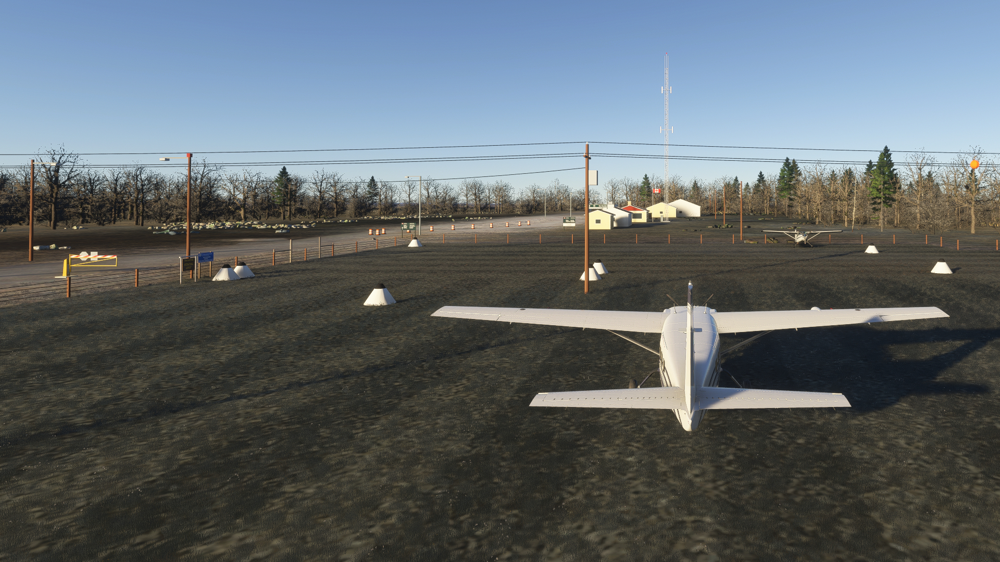
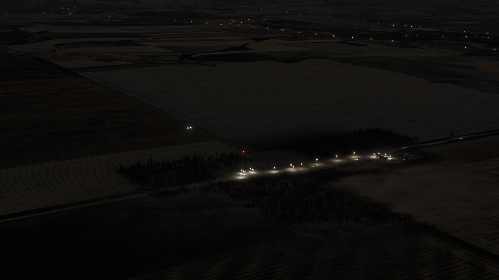
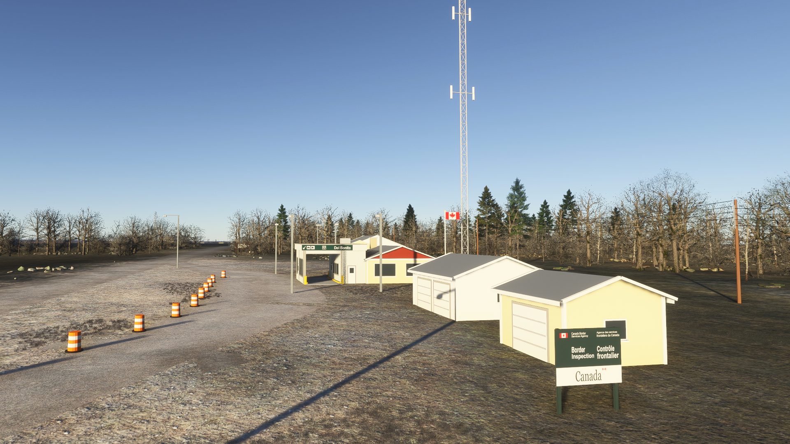
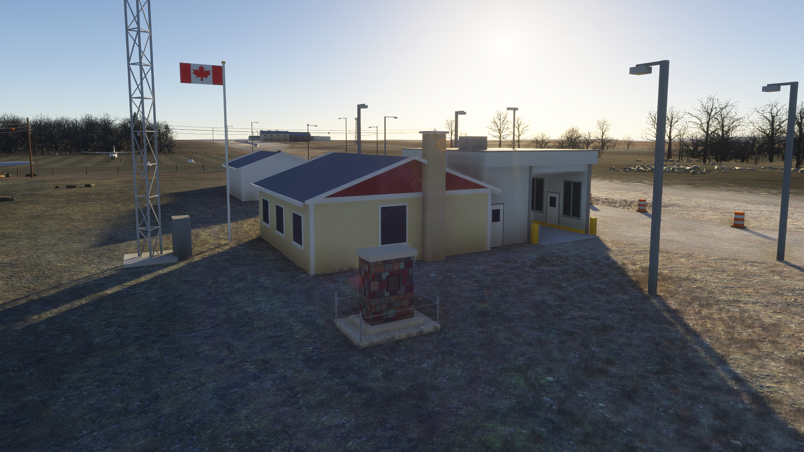
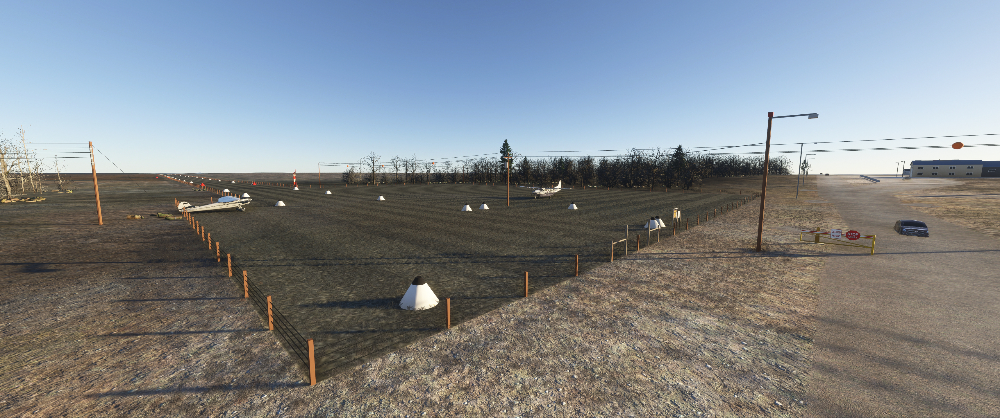
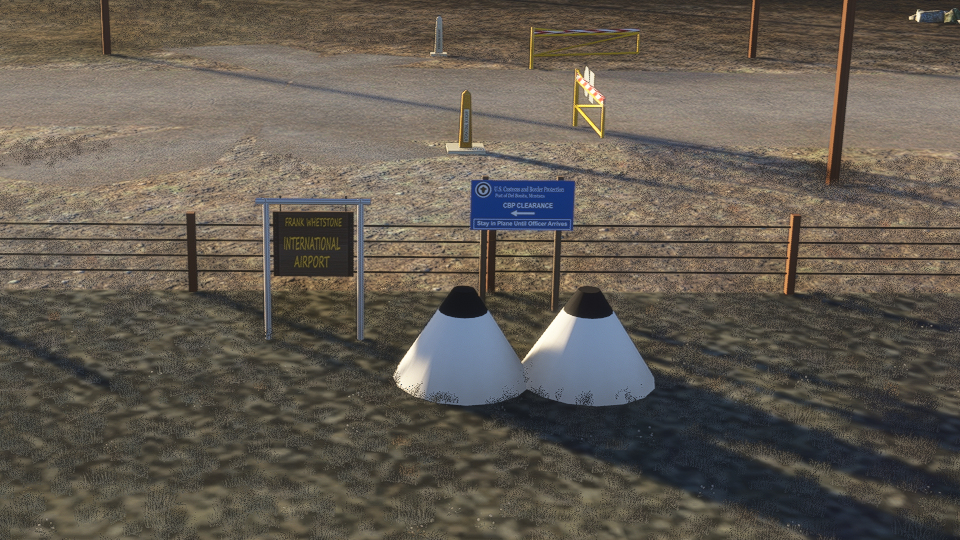

H28/CEQ4 Whetstone/Del Bonita International Airport
===================================================

49°N, 112°46′35″W

Located astride the 49th parallel (i.e. the border between Canada and the
United States), the Whetstone/Del Bonita was originally built during World War
II so the Americans could preserve the appearance of neutrality: the US could
land planes here, and the Canadians (or British) could take off in the
"abandoned" planes already on Canadian soil. There are at least four others like
this (that straddle the border) that still exist.

Today, the airport serves general aviation, and is managed by the State of
Montana, although it retains a Canadian identifier as well. As a bonus, border
crossing facilities are available on-site, due to the highway crossing right
there.

In Microsoft Flight Simulator, I ended up rebuilding it as the airport location
was set just west of the runway proper (rather than the middle of the runway,
which is more typical), and so if you try to land at the marker, you find
yourself short of the runway in a patch of trees! The model here includes the
airport, along with the Canadian and US border crossing buildings, the RCMP
memorial on the Canadian side of the border, the American housing, the border
monuments on both sides of the road, and the surrounding powerlines.

Not true to life, but hopefully more fun to fly, I also added PAPI lights for
west approaches, and an RNAV approach that brings you to circling over the
airport. The border crossing's street lights also make it findable at night
from a distance.

-- Carboard GT, November 23, 2026  
<https://github.com/minchinweb/msfs-airports/tree/master/airport-h28>

Other photos:

Release History
---------------

### v1.0.0 -- November 23, 2026

Initial Release. Includes:

- Runway 07/25 (4,440 ft between the threshold cones) with border fences
- runway cone markers
- PAPI on 07
- windsock
- US parking and Canadian pocket with tie-downs
- CBSA and CBP ports of entry (buildings) with night lighting
- power lines with marker balls
- border monuments 308A/308B and the border gates
- the RCMP cairn
- the Whetstone, CBP and CBSA signs and the Welcome to Alberta sign.
- Fictional RNAV (GPS) RWY 25 and RNAV (GPS)-A approaches (not for real-world
  navigation)
